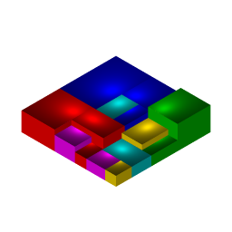
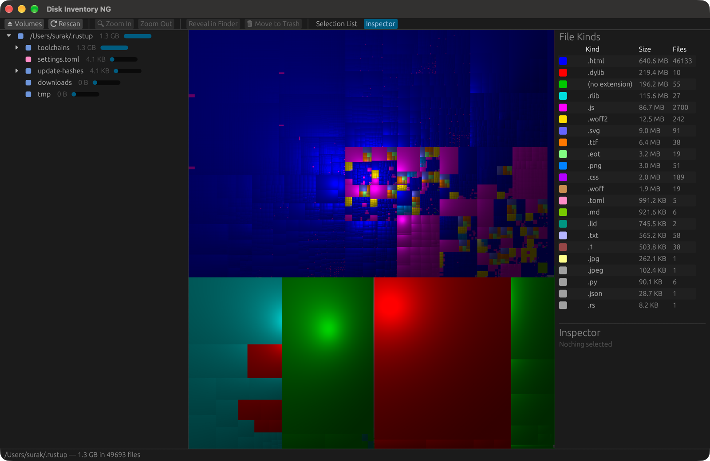
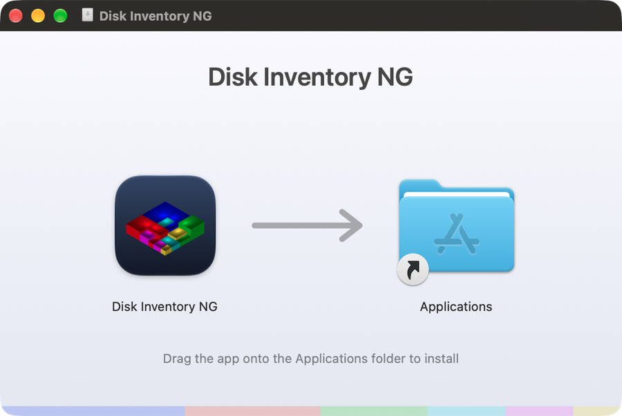

<p align="center">
  
</p>

<h1 align="center">Disk Inventory NG</h1>

<p align="center">
  <b>See where your disk space has gone.</b><br>
  A fast, native disk usage visualizer for macOS, Windows and Linux, written in Rust —<br>
  a modern tribute to <a href="https://www.derlien.com">Disk Inventory X</a> by Tjark Derlien.
</p>

<p align="center">
  <a href="../../releases/latest"></a>
  <a href="https://surak.github.io/diskInventory-NG/"></a>
  <a href="LICENSE"></a>
  
  
</p>

<p align="center">
  
</p>

---

Disk Inventory NG scans a volume or folder and draws every file as a
rectangle in a **cushion treemap**: the bigger the file, the bigger the
rectangle; the colour tells you what kind of file it is. Huge forgotten
downloads, caches and VM images jump right out.

## ✨ Features

- **Cushion treemap** — squarified layout with 3D cushion shading
  (the [KDirStat](https://kdirstat.sourceforge.net/) algorithm), so nested folders stay readable.
- **Three synchronized views** — folder hierarchy, treemap and file-kind
  statistics. Select a file anywhere and the other views follow.
- **Fast** — scans directories in parallel on all CPU cores
  (≈1.4 million entries in under 7 seconds on an Apple Silicon Mac, warm cache).
- **File kinds** — every extension with its total size and file count,
  coloured like the treemap. Click one to list its files.
- **Selection list** — the largest files, filterable by kind and searchable by name.
- **Inspector** — size, share of the total, file count, kind and age of the selection.
- **Zoom** into any folder (double-click or <kbd>⌘</kbd>/<kbd>Ctrl</kbd> <kbd>↓</kbd>) and back out (<kbd>⌘</kbd>/<kbd>Ctrl</kbd> <kbd>↑</kbd>).
- **Act on it** — show in Finder / Explorer / your file manager (<kbd>⌘</kbd>/<kbd>Ctrl</kbd> <kbd>R</kbd>), Open, or Move to Trash (Recycle Bin on Windows);
  the view updates instantly without a rescan.
- **Rescan just one folder** after cleaning up (right-click → *Rescan This Folder*),
  in the background, instead of rescanning the whole disk.
- **Volume list** on launch that follows disks as they are mounted and unmounted.
- Counts hard links once and doesn't wander into other volumes.

## 📦 Install

Download the package for your system from the
[latest release](../../releases/latest):

| System | Download | How to install |
|--------|----------|----------------|
| **macOS** 11+ (Apple Silicon & Intel) | `DiskInventoryNG-x.y.z.dmg` | Open it and drag **Disk Inventory NG** onto **Applications**. |
| **Windows** 10/11 (x64) | `DiskInventoryNG-x.y.z-windows-x64.zip` | Unzip anywhere and run **Disk Inventory NG.exe**. |
| **Linux** PC (x86_64) | `DiskInventoryNG-x.y.z-x86_64.AppImage` | `chmod +x` it and run it. |
| | `DiskInventoryNG-x.y.z-linux-x86_64.tar.gz` | Unpack into `~/.local` or `/usr/local` (binary, desktop entry, icons). |
| **Raspberry Pi** / ARM64 Linux (64-bit OS) | `DiskInventoryNG-x.y.z-aarch64.AppImage` or `…-linux-aarch64.tar.gz` | As above. |
| **Raspberry Pi** (32-bit OS) | `DiskInventoryNG-x.y.z-linux-armhf.tar.gz` | As above. |

Linux builds need glibc 2.35+ (Ubuntu 22.04, Debian 12, Raspberry Pi OS
Bookworm or newer) and OpenGL; on a Raspberry Pi, a Pi 4 or 5 is recommended.

<p align="center"></p>

> [!NOTE]
> The builds are not code-signed by Apple or Microsoft. On **macOS**, right-click
> the app and choose **Open** the first time (or run
> `xattr -dr com.apple.quarantine "/Applications/Disk Inventory NG.app"`).
> On **Windows**, SmartScreen may warn: choose *More info → Run anyway*.

> [!TIP]
> On macOS, give the app **Full Disk Access** in *System Settings → Privacy &
> Security* to scan your whole disk. Without it, macOS hides protected folders
> (Mail, Safari, …) and they are skipped.

## 🛠 Build from source

Requires a stable [Rust](https://rustup.rs) toolchain. On Debian/Ubuntu also install
`libxcb-render0-dev libxcb-shape0-dev libxcb-xfixes0-dev libxkbcommon-dev libgl1-mesa-dev`.

```sh
git clone https://github.com/surak/diskInventory-NG.git
cd diskInventory-NG
cargo run --release                 # start with the volume list
cargo run --release -- ~/Downloads  # or scan a folder right away
```

### Packages

```sh
scripts/bundle-macos.sh             # → target/release/bundle/Disk Inventory NG.app
scripts/make-dmg.sh                 # → target/release/bundle/DiskInventoryNG-<version>.dmg
scripts/make-dmg.sh universal       # arm64 + x86_64 (rustup target add x86_64-apple-darwin)
scripts/package-linux.sh            # → .tar.gz, plus an .AppImage if appimagetool is installed
pwsh scripts/package-windows.ps1    # → .zip with the .exe (icon embedded)
```

Pushing a tag like `v0.2.0` builds all of these on GitHub Actions and attaches
them to a release.

`make-dmg.sh` lays out the installer window through Finder, so the first run
may ask to allow your terminal to control Finder.

The app icon — an isometric 3D treemap, in homage to the original — is not a
bitmap in the repo: the app draws it itself with its own treemap renderer
(`disk-inventory-ng --write-icon icon.png 1024`).

### Benchmark the scanner

```sh
cargo run --release -- --scan-only ~/Library
```

## 🧭 How it works

| File | Purpose |
|------|---------|
| [`src/scan.rs`](src/scan.rs) | Parallel directory walk (rayon), flattened into an arena tree with per-kind statistics |
| [`src/treemap.rs`](src/treemap.rs) | Squarified layout and cushion shading, rendered to a texture |
| [`src/app.rs`](src/app.rs) | The [egui](https://github.com/emilk/egui) user interface |
| [`src/icon.rs`](src/icon.rs) | Procedural isometric treemap app icon |
| [`src/volumes.rs`](src/volumes.rs) | Mounted volume discovery |
| [`src/platform.rs`](src/platform.rs) | OS specifics: file sizes, file manager, shortcuts |
| [`src/kinds.rs`](src/kinds.rs) | File kind colour palette |
| [`scripts/`](scripts) | Packaging: `.app` + DMG, Linux tarball + AppImage, Windows zip |

On macOS and Linux, sizes are *allocated* sizes on disk (blocks × 512), like Finder's
"on disk" figure; on Windows they are file sizes.

## 🙏 Acknowledgements

**Disk Inventory NG exists because of [Disk Inventory X](https://www.derlien.com)
by [Tjark Derlien](https://www.derlien.com).** For years, Disk Inventory X was
the tool Mac users reached for when their disk was mysteriously full. Its idea of
three synchronized views — folder hierarchy, cushion treemap and file kinds — is
the design this project follows, and the app icon is a homage to its isometric
3D treemap.

**Thank you, Tjark,** for creating Disk Inventory X, for sharing it with the
world for free and as open source (under the GPL), and for showing how useful a
picture of your disk can be. This project is our attempt to carry that idea
forward, on modern macOS and now on Windows and Linux too.

Disk Inventory X itself stood on the shoulders of others, and so do we:

- [KDirStat](https://kdirstat.sourceforge.net/) by Stefan Hundhammer, whose
  treemap layout Disk Inventory X used, and
  [WinDirStat](https://windirstat.net/), which inspired it.
- *Cushion Treemaps* (Jarke J. van Wijk & Huub van de Wetering, 1999) and
  *Squarified Treemaps* (Mark Bruls, Kees Huizing & Jarke J. van Wijk, 2000).
- [Treemaps](https://www.cs.umd.edu/hcil/treemap-history/), invented by Ben Shneiderman.

Disk Inventory NG is an independent reimplementation in Rust. It contains no code
or artwork from Disk Inventory X and is not affiliated with or endorsed by its
author. "Disk Inventory X" is the name of Tjark Derlien's original application.

## 📄 License

[MIT](LICENSE) © 2026 Alexandre Strube
